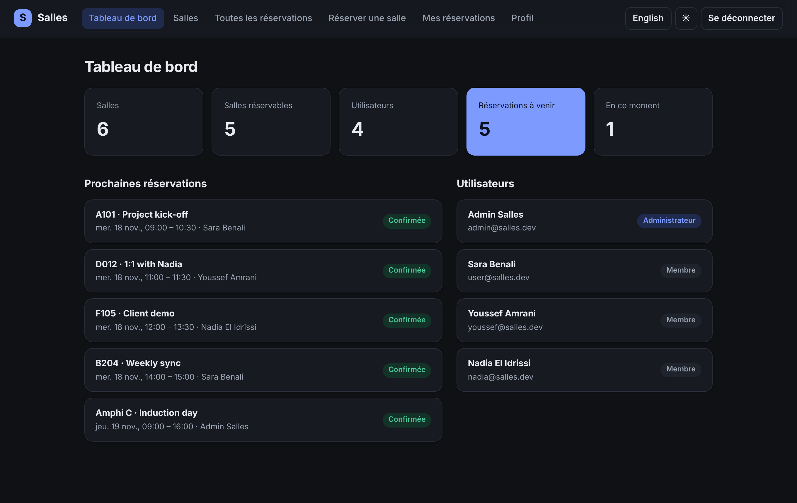
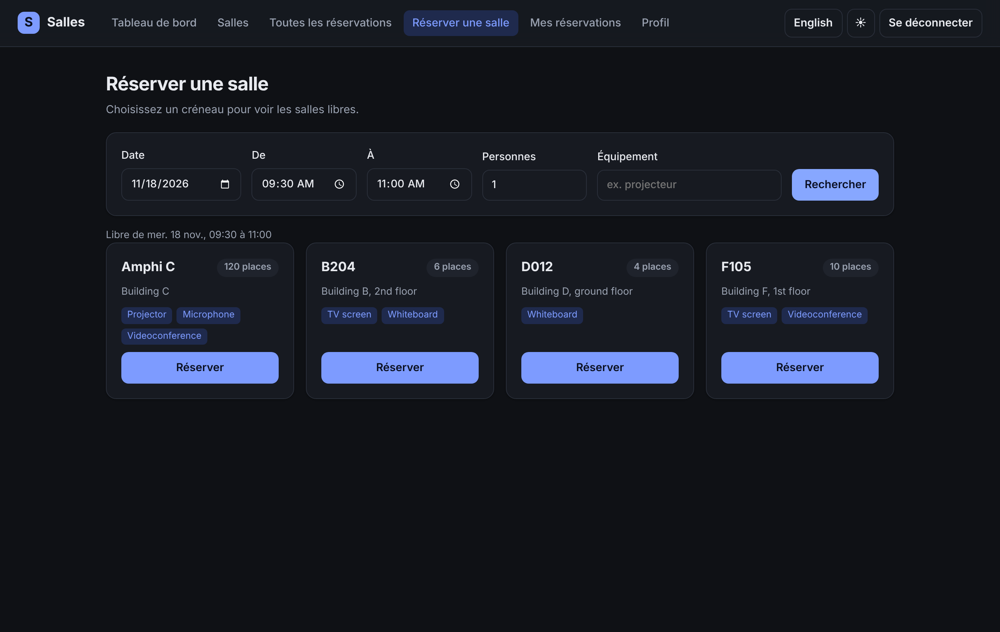
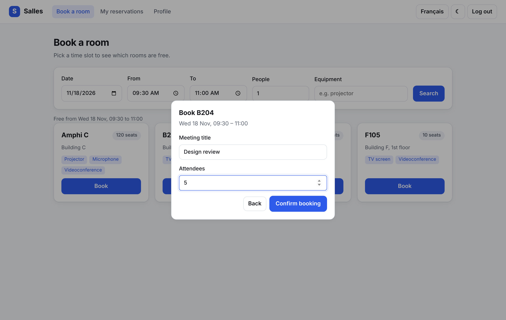
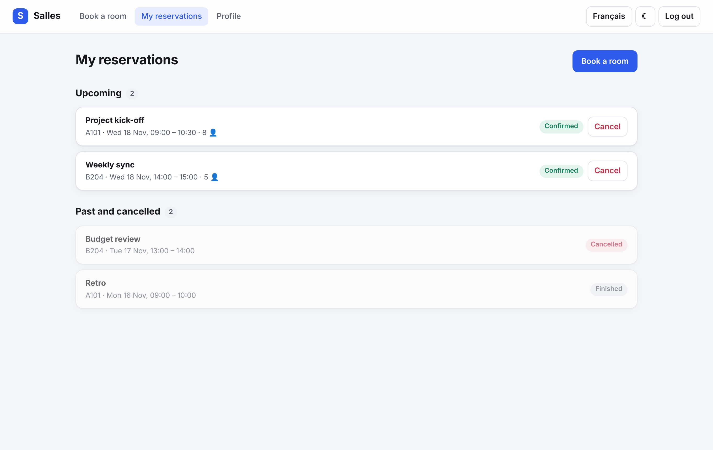
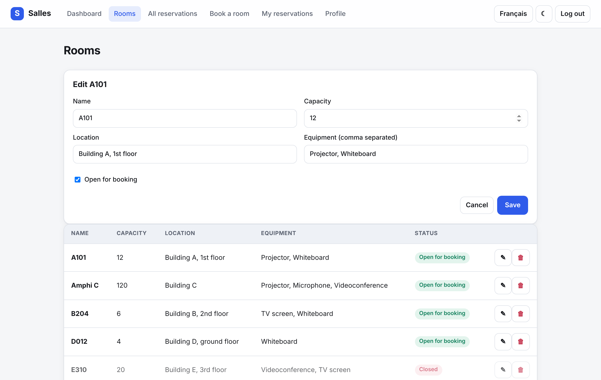
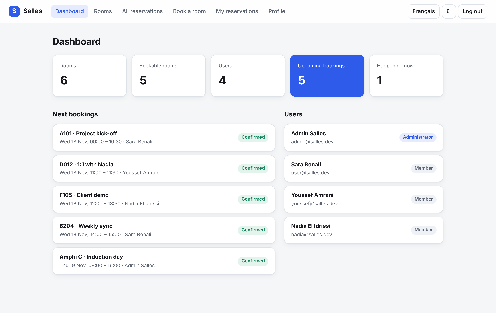
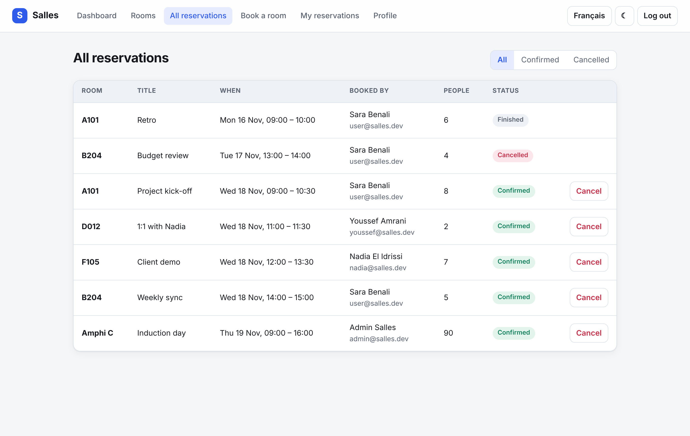
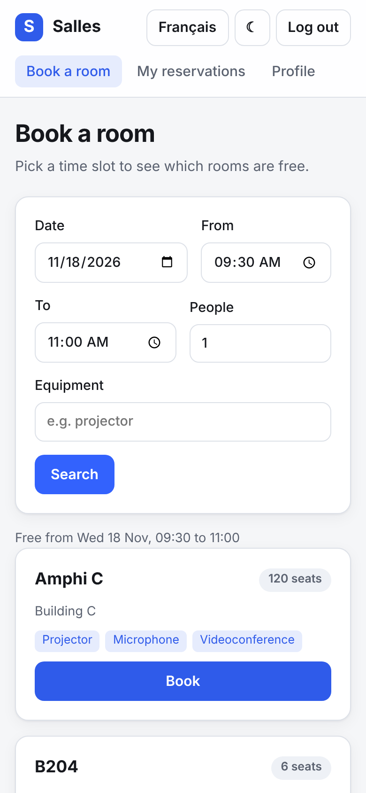
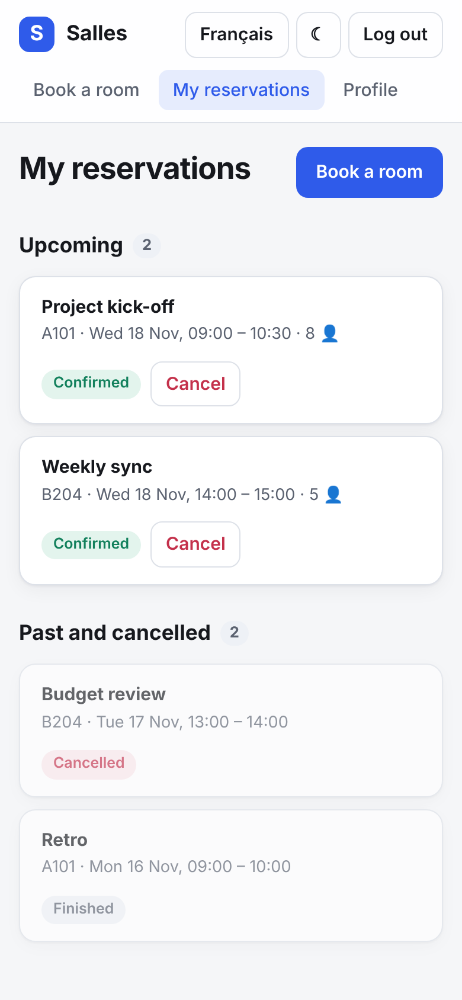
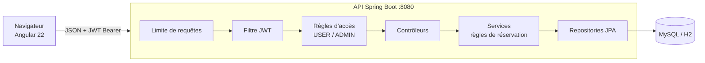

<div align="center">

# 🏢 Salles — Réservation de salles de réunion

**Trouvez une salle libre, réservez-la en deux clics, fini les doubles réservations.**
Une application full-stack avec une API Spring Boot et un front-end Angular, pour les membres et les administrateurs.

[](https://github.com/Zakariae4AL/Reservation_des_salles/actions/workflows/ci.yml)


[🇬🇧 English](README.md) · 🇫🇷 Français



</div>

## Sommaire

- [Fonctionnalités](#fonctionnalités)
- [Captures d’écran](#captures-décran)
- [Technologies](#technologies)
- [Architecture](#architecture)
- [Démarrage](#démarrage)
- [Configuration](#configuration)
- [API](#api)
- [Sécurité](#sécurité)
- [Tests](#tests)
- [Structure du projet](#structure-du-projet)
- [Auteurs](#auteurs)

## Fonctionnalités

**Membres**
- 🔎 Recherche de salles par **date et créneau**, nombre de personnes et équipement — seules les salles libres sur tout le créneau sont affichées.
- 📅 Réservation dans une fenêtre (titre, participants). L’API refuse les chevauchements, les créneaux passés, les réservations de plus de 12 h et les salles trop petites.
- 🗂️ **Mes réservations** : à venir, en cours, terminées et annulées, avec annulation en un clic.
- 👤 Page profil avec votre rôle et vos réservations à venir.

**Administrateurs**
- 📊 **Tableau de bord** : salles, salles réservables, utilisateurs, réservations à venir et en cours, prochaines réservations, liste des utilisateurs.
- 🏗️ **Gestion des salles** : créer, modifier, fermer (garde l’historique) ou supprimer.
- 📋 **Toutes les réservations** avec filtre par statut ; l’administrateur peut annuler n’importe quelle réservation.

**Pour tous**
- 🌍 Interface en anglais et en français, mémorisée par navigateur.
- 🌗 Thème clair et sombre, qui suit le système par défaut.
- 📱 Responsive et utilisable au clavier (lien d’évitement, focus visible, vrai `<dialog>`, libellés ARIA).

## Captures d’écran

| Recherche (sombre, français) | Réserver une salle |
| :---: | :---: |
|  |  |
| **Mes réservations** | **Gestion des salles** |
|  |  |
| **Tableau de bord** | **Toutes les réservations** |
|  |  |

<p align="center">
  
  &nbsp;&nbsp;
  
</p>

## Technologies

| Couche | Technologies |
| --- | --- |
| **Backend** | Java 21, Spring Boot 4.1, Spring Security, Spring Data JPA (Hibernate), Bean Validation, JWT (jjwt), Actuator |
| **Base de données** | MySQL 8 en production, H2 en développement et pour les tests |
| **Frontend** | Angular 22 (composants standalone, signals, zoneless), Reactive Forms, intercepteur et guards fonctionnels |
| **Tests** | JUnit 5, MockMvc, AssertJ · Vitest, Angular TestBed, HttpTestingController |
| **Outils** | Maven wrapper, Prettier, GitHub Actions, Docker |

## Architecture



**Comment les doubles réservations sont évitées.** Deux réservations se chevauchent quand `existante.début < nouvelle.fin` **et** `existante.fin > nouvelle.début`. Avant la vérification, le service **verrouille la ligne de la salle** (`SELECT … FOR UPDATE`) : deux personnes qui cliquent sur « Réserver » au même moment sont traitées l’une après l’autre. Les réservations qui se suivent (10:00–11:00 puis 11:00–12:00) sont autorisées.

## Démarrage

### Prérequis

- **Java 21** (par exemple [Temurin](https://adoptium.net/))
- **Node.js 24** (ou 22.22+) et npm
- MySQL 8 seulement en production — le développement utilise une base H2 dans un fichier, rien à installer.

### 1. Lancer l’API

```bash
cd backend
./mvnw spring-boot:run        # Windows : mvnw.cmd spring-boot:run
```

L’API tourne sur <http://localhost:8080>, avec des données de démo :

| Compte | E-mail | Mot de passe |
| --- | --- | --- |
| Administrateur | `admin@salles.dev` | `Demo1234` |
| Membre | `user@salles.dev` | `Demo1234` |

### 2. Lancer le front-end

```bash
cd frontend
npm install
npm start
```

Ouvrez <http://localhost:4200>. En développement, les appels `/api` sont redirigés vers le port 8080 (`frontend/proxy.conf.json`), donc pas de CORS à configurer.

### Production

```bash
# API avec MySQL
export SPRING_PROFILES_ACTIVE=prod
export DB_URL="jdbc:mysql://localhost:3306/salles"
export DB_USERNAME=salles DB_PASSWORD='un-mot-de-passe-solide'
export JWT_SECRET="$(openssl rand -base64 48)"
export CORS_ORIGINS="https://salles.example.com"
cd backend && ./mvnw -B package && java -jar target/*.jar

# Ou avec Docker
docker build -t salles-api backend

# Front-end : fichiers statiques à servir sur le même domaine (/api → l’API)
cd frontend && npm ci && npm run build   # résultat dans dist/frontend/browser
```

## Configuration

Tous les réglages viennent de variables d’environnement (voir `backend/src/main/resources/application*.properties`).

| Variable | Défaut (dev) | Description |
| --- | --- | --- |
| `PORT` | `8080` | Port HTTP de l’API |
| `DB_URL` | fichier H2 dans `./data` | URL JDBC (obligatoire en `prod`) |
| `DB_USERNAME` / `DB_PASSWORD` | `sa` / vide | Identifiants de la base (obligatoires en `prod`) |
| `JWT_SECRET` | valeur de dev | Clé HMAC, **au moins 32 octets**. L’application refuse de démarrer en `prod` avec la valeur de dev |
| `JWT_TTL` | `8h` | Durée de vie du jeton |
| `CORS_ORIGINS` | `http://localhost:4200` | Origines autorisées, séparées par des virgules |
| `AUTH_RATE_LIMIT` | `10` | Tentatives de connexion / inscription par minute et par IP |
| `SEED_DEMO` | `true` (`false` en `prod`) | Crée les comptes, salles et réservations de démo |

## API

URL de base : `/api/v1`. Envoyez `Authorization: Bearer <jeton>` sur chaque appel sauf inscription et connexion. Les erreurs suivent la [RFC 9457 (Problem Details)](https://www.rfc-editor.org/rfc/rfc9457).

| Méthode | Endpoint | Accès | Description |
| --- | --- | --- | --- |
| `POST` | `/auth/register` | Public | Crée un compte membre, renvoie un jeton |
| `POST` | `/auth/login` | Public | Connexion, renvoie un jeton |
| `GET` | `/auth/me` | Connecté | Utilisateur courant |
| `GET` | `/rooms?from&to&minCapacity&equipment` | Connecté | Salles, éventuellement seulement celles libres entre `from` et `to` |
| `GET` | `/rooms/{id}` | Connecté | Une salle |
| `GET` | `/rooms/{id}/schedule?from&to` | Connecté | Créneaux occupés d’une salle |
| `POST` | `/rooms` | Admin | Crée une salle |
| `PUT` | `/rooms/{id}` | Admin | Modifie une salle |
| `DELETE` | `/rooms/{id}` | Admin | Supprime une salle sans réservation (sinon, la fermer) |
| `GET` | `/reservations/mine` | Connecté | Mes réservations |
| `POST` | `/reservations` | Connecté | Réserve une salle |
| `POST` | `/reservations/{id}/cancel` | Propriétaire / Admin | Annule une réservation |
| `GET` | `/admin/stats` | Admin | Chiffres du tableau de bord |
| `GET` | `/admin/users` | Admin | Tous les utilisateurs |
| `GET` | `/admin/reservations?status` | Admin | Toutes les réservations |
| `GET` | `/actuator/health` | Public | État de santé |

## Sécurité

| Risque | Ce que fait l’application |
| --- | --- |
| Base de données volée | Mots de passe hachés avec **BCrypt**, jamais renvoyés par l’API |
| Devenir admin tout seul | Le rôle est **forcé à `USER`** à l’inscription ; les routes admin sont vérifiées par l’API (`403`) |
| Jetons falsifiés ou expirés | JWT signé en HMAC-SHA256, expiration vérifiée, `alg: none` refusé, utilisateur rechargé à chaque requête (un compte supprimé perd l’accès immédiatement) |
| Deviner un mot de passe | Connexion / inscription **limitées par IP** ; même message et même calcul de hachage pour un e-mail inconnu et un mauvais mot de passe |
| Lire les données d’un autre | Un utilisateur ne voit et n’annule que **ses propres** réservations (`404` pour les autres) |
| Double réservation (accès concurrents) | **Verrou** sur la salle + vérification de chevauchement dans une seule transaction |
| Secrets exposés | Identifiants de base et secret JWT en variables d’environnement ; `prod` refuse le secret de dev |
| Données invalides | Bean Validation sur chaque requête ; `400` clair avec une liste `errors` par champ |
| Fuite d’informations | Pas de stack trace dans les réponses ; seul `/actuator/health` est exposé |
| Redirection ouverte après connexion | `?next=` n’est suivi que pour des chemins internes à l’application |
| XSS | Angular échappe toutes les valeurs affichées ; le jeton n’est envoyé qu’à l’URL de l’API |

## Tests

```bash
cd backend && ./mvnw verify     # 30 tests d’intégration et unitaires (H2 en mémoire)
cd frontend && npm test         # 33 tests de composants et de services (Vitest)
```

Les tests du backend démarrent toute l’application et envoient de vraies requêtes HTTP à travers les filtres de sécurité : inscription et connexion, jetons falsifiés / expirés / non signés, accès admin contre membre, filtres de salles, chaque règle de réservation (chevauchements, créneaux consécutifs, passé, trop long, capacité, salle fermée), règles d’annulation, statistiques admin et limitation de requêtes.

GitHub Actions lance les deux suites, la vérification des types, le contrôle du formatage et le build de production à chaque push et pull request.

## Structure du projet

```
.
├── backend/                     API Spring Boot
│   ├── src/main/java/reservationsalles/
│   │   ├── auth/                JWT, filtres, inscription / connexion
│   │   ├── room/                salles, recherche, planning
│   │   ├── reservation/         règles de réservation, annulation
│   │   ├── admin/               statistiques, utilisateurs, toutes les réservations
│   │   ├── user/                comptes et rôles
│   │   ├── common/              erreurs (Problem Details)
│   │   └── config/              sécurité, CORS, données de démo
│   └── src/test/java/           tests d’intégration et unitaires
├── frontend/                    application Angular
│   └── src/app/
│       ├── core/                client API, auth, guards, i18n, thème
│       ├── layout/              en-tête, navigation, notifications, confirmation
│       ├── pages/               salles, réservations, profil, admin/*
│       └── shared/              badge de statut, notifications, confirmation
├── docs/screenshots/
└── .github/workflows/ci.yml
```

## Auteurs

- **Zakariae** — [@Zakariae4AL](https://github.com/Zakariae4AL)
- **Asmae Abouhadid** — co-autrice de la première version

Publié sous [licence MIT](LICENSE).
